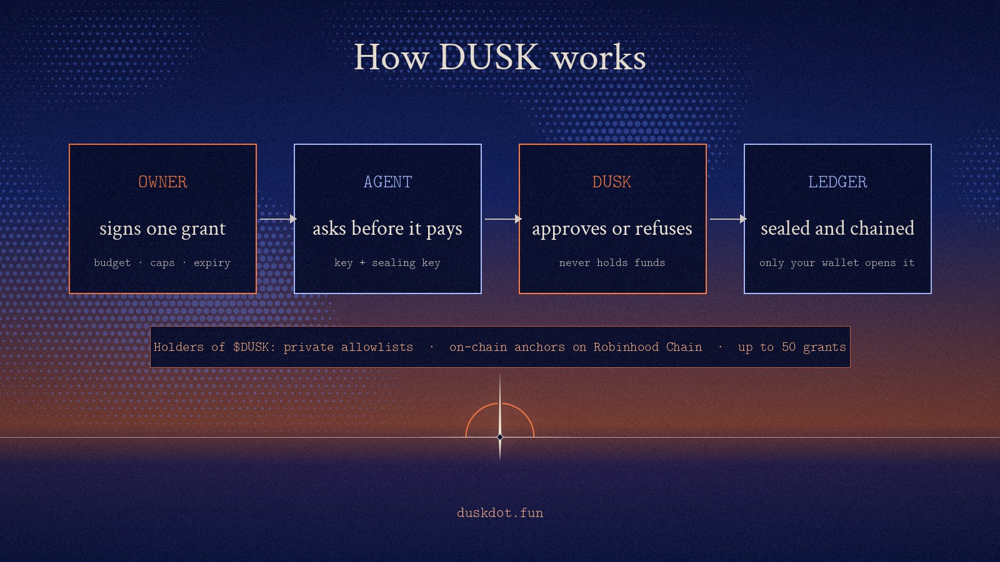

<p align="center"></p>

<h1 align="center">DUSK</h1>
<p align="center"><b>Private spending for AI agents.</b><br>Spent in silence. Bound by proof.</p>
<p align="center"><a href="https://duskdot.fun">duskdot.fun</a> · <a href="https://x.com/DuskAgents">@DuskAgents</a> · Robinhood Chain</p>
<p align="center"><b>$DUSK</b> <code>0x99c2a41ebddcade297e241fd152aa237d16832bc</code></p>

---

AI agents pay for data, search, models and compute on their own. Every call is a payment, and every payment says something about what you are building. On-chain, anyone can follow that trail.

DUSK lets you hand an agent a spending key with hard limits, while what it buys stays sealed. DUSK never holds funds and never sees what your agent paid for.

<p align="center"></p>

## How it works

**Sign one grant.** Set a total budget, a cap per call, a cap per day and an expiry, then sign it with your wallet. A signature, not a transaction: no gas, no deposit.

**Hand your agent a key.** Your browser creates the agent key and a sealing key. DUSK only stores a SHA-256 hash of the key token. The sealing key never reaches DUSK.

**Your agent asks before it pays.** Inside the limits, approved. Over a cap, expired, paused or revoked, refused. The agent pays the seller from its own wallet.

**Every payment is sealed.** The agent encrypts the seller, the request and the note with AES-GCM before they reach DUSK. Each ledger entry carries the hash of the one before. Only your wallet can open the ledger.

**Proof, not promises.** Anyone can load a grant and recover the signer in their own browser.

**Private allowlists.** Each allowed seller becomes an HMAC tag keyed with your sealing key. DUSK enforces the list without ever learning a name.

**On-chain anchors.** Pin your ledger head on Robinhood Chain with a zero-value transaction to yourself. Once anchored, no one can rewrite the history, DUSK included.

**$DUSK holders.** Every vault gets 3 active grants. Holders get up to 50. The balance is read live on Robinhood Chain.

## For agents

```js
import { createDusk } from './client/dusk-agent.mjs';

const dusk = createDusk(process.env.DUSK_AGENT_KEY); // <grantId>.<token>.<sealingKey>

const r = await dusk.spend({ amount: '0.0025', seller: 'api.vendor.dev/search', request: 'lithium supply 2026' });
if (r.ok) {
  // pay the seller from your agent wallet
} else {
  console.log(r.error); // over per-call limit, over budget, paused, not on allowlist...
}
```

No dependencies. Runs on Node 18+, Deno, Bun, browsers and Workers. See [`examples/agent.mjs`](examples/agent.mjs).

**Owner approval (V3).** Set an ask-above amount on a grant and every bigger payment waits for your yes in the vault. `spend` then answers `{ ok: false, pending: true, request }`: call `await dusk.wait(request)` and pay only if the status is `approved`. Set a per-seller daily cap and no single seller can take more than that in a day.

Test before you pay: `await dusk.check({ amount: '0.0025', seller: 'api.vendor.dev' })` runs the same checks as `spend`, and nothing is spent or recorded.

### MCP server

Plug DUSK into any MCP agent (Claude Desktop, Claude Code, Cursor and others). No dependencies, Node 18+.

```json
{
  "mcpServers": {
    "dusk": {
      "command": "node",
      "args": ["/path/to/dusk/mcp/dusk-mcp.mjs"],
      "env": { "DUSK_AGENT_KEY": "<grantId>.<token>.<sealingKey>" }
    }
  }
}
```

Your agent gets four tools: `dusk_limits`, `dusk_check` (dry run), `dusk_spend` and `dusk_status`. It calls `dusk_spend` before every payment and pays only when DUSK approves. The sealing key never leaves your machine.

### Python

```python
# pip install cryptography
from dusk_agent import Dusk

dusk = Dusk(os.environ["DUSK_AGENT_KEY"])
r = dusk.spend("0.0025", "api.vendor.dev/search", request="lithium supply 2026")
if r["ok"]:
    ...  # pay the seller from your agent wallet
```

Same calls as the JS client: `limits()`, `check()`, `spend()`. See [`python/dusk_agent.py`](python/dusk_agent.py).

## V4: on-chain vault

Limits, enforced on-chain. [`contracts/src/DuskVault.sol`](contracts/src/DuskVault.sol) runs on Robinhood Chain.

The owner locks stablecoins (USDG by default, any ERC-20 works) in a vault and names the agent's wallet. The agent calls `pay(vault, seller, amount, memo)` and the contract pays the seller in the same transaction, only inside the limits: per payment, per day, per seller per day, balance and expiry. Above the owner's ask-me amount, the payment waits for `approve` or `decline`. Everything else reverts.

The owner can `setPaused`, `setAgent` (rotate the agent wallet), `topUp`, `withdraw` and `close` (everything left goes back). There is no admin, no upgrade and no override: nobody but the owner can touch a vault.

Plug it into Claude, Cursor or any MCP agent: set `DUSK_AGENT_WALLET_KEY` and `DUSK_VAULT_ID` for [`mcp/dusk-mcp.mjs`](mcp/dusk-mcp.mjs) and your AI gets `dusk_vault`, `dusk_vault_check` and `dusk_vault_pay`. In code, [`client/dusk-vault.mjs`](client/dusk-vault.mjs) does the same with no dependencies: `createVault({ key, vault }).pay(seller, '0.05')`.

`canPay(vault, seller, amount)` tells an agent ahead of time: `0` pays now, `1` waits for the owner, `2+` refused. Sellers confirm a payment with `GET /api/v4/paid?tx=0x…`.

```bash
cd contracts && forge test
```

## For sellers

Your API serves AI agents. Before you serve one, ask DUSK if it runs on a live grant its owner signed.

The agent sends `X-Dusk-Grant` (its grant id) and, once DUSK approved the payment, `X-Dusk-Receipt` (`n.hash` from its receipt). No key, no secret.

```js
import { duskVerify } from './seller/dusk-verify.mjs';

const v = await duskVerify(request.headers, '0.05');
if (!v.ok) return new Response(v.error, { status: 402 });
```

`GET /api/verify/:grant?amount=0.05&receipt=n.hash` returns `verified` (signature recovers, active, not expired), `amount.covers` (your price fits its limits right now), `receipt.valid` (the payment is in the signed ledger) and `holder` ($DUSK holder). Open to anyone, 60 calls a minute.

Show it on your site:

```html
<a href="https://duskdot.fun/#sellers"></a>
```

## Budget forecast

`GET /api/agent` and the vault return `forecast`: the pace in USDC a day, how many days the budget lasts at that pace, and `low` when less than 20% is left. The vault warns you before an agent runs dry.

## API

| Method | Route | Auth | |
|---|---|---|---|
| GET | `/api/stats` | none | grants, payments, owners, volume |
| GET | `/api/feed` | none | recent activity, no content |
| GET | `/api/tier` | none | holder threshold and grant limits, or `?address=0x…` for one wallet's tier |
| GET | `/api/ca` | none | $DUSK contract address |
| GET | `/api/agent01` | none | Agent 01, the public demo agent: its grant and every decision |
| GET | `/api/proof/:id` | none | signed terms, status, ledger head, anchors |
| GET | `/api/v4` | none | vault contract address and default token |
| GET | `/api/v4/paid?tx=` | none | payments a transaction made from a DUSK vault |
| POST | `/api/chain` | none | read-only Robinhood Chain calls for the page |
| GET | `/api/verify/:id` | none | seller check: `?amount=` and `?receipt=n.hash`, returns verified, covers, receipt valid |
| POST | `/api/login` | wallet signature | session |
| GET | `/api/vault` | session | your grants and tier |
| POST | `/api/grants` | session + grant signature | create a grant |
| POST | `/api/grants/:id/status` | session | pause, resume, revoke |
| POST | `/api/grants/:id/rotate` | session | new agent key, same grant; the old key stops at once |
| POST | `/api/vault/status` | session | pause or resume every grant at once |
| GET | `/api/grants/:id/ledger` | session | sealed entries |
| POST | `/api/grants/:id/anchor` | session | record an on-chain anchor |
| GET | `/api/agent` | agent key | limits and status |
| GET | `/api/spend/:request` | agent key | status of a payment waiting for the owner |
| POST | `/api/grants/:id/requests/:request` | session | owner approves or declines a waiting payment |
| POST | `/api/check` | agent key | `{ amount, tag }`, dry run, nothing recorded |
| POST | `/api/spend` | agent key | `{ amount, sealed, tag }` |

## Protocol

Signatures are EIP-191 `personal_sign`, recovered with secp256k1 in the Worker and in the page. Amounts are USDC with 6 decimals.

**Grant message**

```
DUSK grant
Grant: <id>
Owner: <address>
Budget: <amount> USDC
Per call: <amount> USDC
Daily: <amount> USDC
Allowlist: <sha256 of sorted tags joined by ",">   (only when set)
Expires: <ISO date>
Issued: <ISO date>
```

**Ledger**

```
genesis = sha256("dusk:" + grantId + ":" + signature)
entry_n = sha256(prev | n | timestamp | amount | sealed)
```

**Allowlist tag**

```
host = lowercase(seller) without scheme and path
tag  = hex(HMAC-SHA256(sealingKey, host))
```

**Anchor**

A zero-value transaction from the owner to itself on Robinhood Chain (chain id 4663), with data:

```
"DUSK anchor\n" + grantId + "\n" + count + "\n" + head
```

The Worker checks `from`, `to` and `input` with `eth_getTransactionByHash` before recording it.

## Run your own

```bash
npx wrangler kv namespace create DUSK_DB   # paste the id in wrangler.toml
python3 build.py                           # src/ -> worker.js + public/index.html
npx wrangler deploy
npx wrangler kv key put --binding=DB ca 0xYOUR_TOKEN --remote   # optional, enables holder tier
```

## Layout

```
src/ecc.js           keccak256 + secp256k1 recovery, shared by Worker and page
src/worker_body.js   API, limits, sealed ledger, anchors
src/index.src.html   the site
client/              drop-in agent client
mcp/                 MCP server for agents
python/              Python client
seller/              seller check for APIs that serve agents
contracts/           V4 vault contract and tests (Foundry)
worker.js, public/   built output
```

## License

MIT
